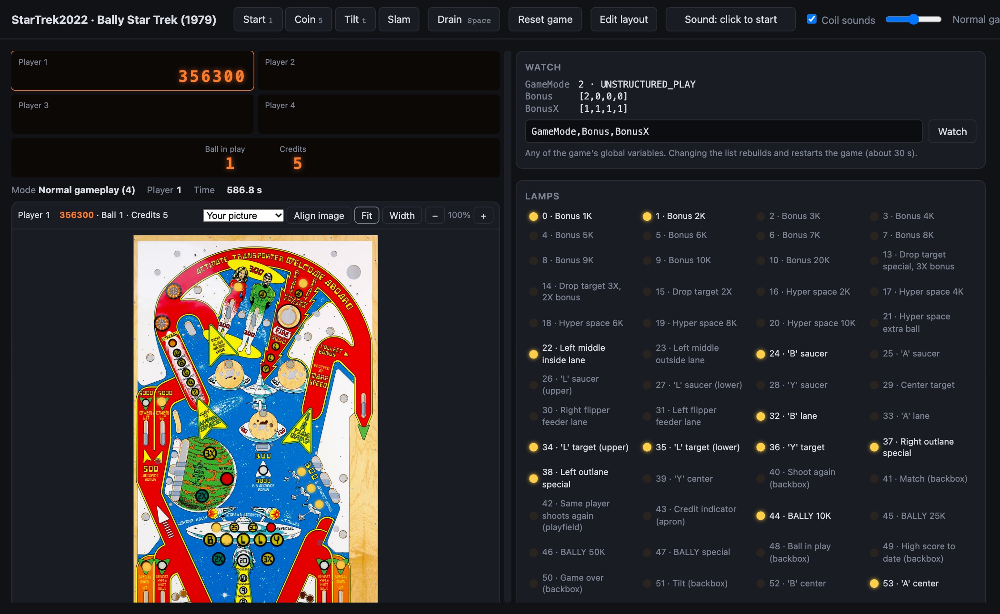

# rpu-sim



Runs a RetroPinUpgrade (RPU) game on your computer, with no Mega and no machine. The game's
own code (the sketch, `DisplayHandler`, `OperatorMenus`, `AudioHandler`) is compiled for the
host and linked against `sim_core.cpp`, which stands in for the Arduino core, `RPU.cpp`
(switches, lamps, displays, coils) and the WAV Trigger on Serial1. Games that include PinNode.h
also get the PinNode library's `PinNodeCtrl` and a simulated link to its node. Scenario files drive it: switch
closures, time passing, and checks on what the game did.

```bash
./run.sh ~/src/ExampleMachineMEGA examples/ExampleMachine/01-start-a-game.sim   # build, run a scenario
./run.sh ~/src/MyGame examples/pin-node-example/01-full-game.sim   # a game with PinNode
./build/MyGame/sim -v examples/pin-node-example/01-full-game.sim   # again, with the full log
SIM_DEFINES="-DMACHINE_BALLY_STAR_TREK" ./run.sh ~/src/MyGame examples/pin-node-example-star-trek/01-star-trek-coils.sim
```

`examples/` has scenarios for Dick Hamill's [ExampleMachine](https://github.com/RetroPinUpgrade/ExampleMachine)
(plain RPU) and for [PinNode-Example](https://github.com/pin-node/PinNode-Example) (RPU with PinNode).

**Needs:** the Arduino IDE (its `arduino-cli` adds the sketch's function prototypes; set
`ARDUINO_CLI` if yours is somewhere else), `clang++`, and Python 3. Only games that include PinNode.h need
the PinNode library (Library Manager: PinNode; or set `PINNODE_LIB`). Games that include a
machine header need RPUMachines (Library Manager; or set `MACHINES_LIB`).

## Getting started (Mac)

rpu-sim runs on a Mac. The game is compiled into a Mac program (`clang++`), the page is just its
display, and `--manual` uses macOS's PDF renderer. A port to Linux or Windows (or WSL), or to
WebAssembly so it runs entirely in a browser, would be welcome: the game code and `sim_core.cpp` are
plain C++, and `play.py` is Python. Most of a port is `build.sh` and the page renderer.

1. Install Apple's Command Line Tools (for `clang++` and `swift`; not the full Xcode app):
   `xcode-select --install`. `xcode-select -p` shows whether you already have them.
2. Install the [Arduino IDE](https://www.arduino.cc/en/software). Python 3 comes with macOS.
3. Get rpu-sim and an RPU game, then run a scenario:

```bash
git clone https://github.com/wifijt/rpu-sim
git clone https://github.com/RetroPinUpgrade/ExampleMachine ExampleMachineMEGA   # folder = sketch name
cd rpu-sim
./run.sh ../ExampleMachineMEGA examples/ExampleMachine/01-start-a-game.sim
```

It prints `PASS` (or `FAIL` and the line that failed). Add `-v` to see the whole log:
`./build/ExampleMachineMEGA/sim -v examples/ExampleMachine/01-start-a-game.sim`.

The first build takes a minute; later ones are quicker. The build goes to `build/<sketch name>/`.

## Your own game

Make a folder for your scenarios, say `MyGame/sim/`, with two files.

**`machine.sim`: what the playfield does on its own.** A real ball moves when a coil fires; here
you say which switches that opens. Where the ball starts goes here too.

```
# The outhole kicker serves the ball: the outhole switch opens
physics SOL_OUTHOLE opens SW_OUTHOLE
# The saucer kicks out its ball
physics SOL_SAUCER opens SW_SAUCER
# The drop target bank reset stands all three targets up
physics SOL_DROP_RESET opens SW_DROP_1 SW_DROP_2 SW_DROP_3
# Power on with the ball in the outhole
close SW_OUTHOLE
```

Use your game's own names (the `SW_`, `SOL_` and `LAMP_` defines in its headers).

**A scenario: something to check.** For example, that a game starts, scores and ends a ball:

```
include machine.sim
run 3000                    # power on and settle into attract
check state == 0            # attract mode

press SW_CREDIT_RESET       # Start
run 3000
# the ball was served
expect SOL fire SOL_OUTHOLE
check ball == 1

press SW_POP_BUMPER         # hit something (a ball that drains untouched is served again)
check score 1 >= 1
run 60000                   # past any ball save
close SW_OUTHOLE            # drain
run 8000
check ball == 2
```

Run it with `./run.sh path/to/MyGame MyGame/sim/01-start.sim`. When a check fails, run again with
`-v` and read the log around that time.

**Tips**
- Times are in milliseconds of game time. A long `run` takes a moment, not a minute.
- `press` closes a switch for 40 ms. Use `close` and `open` for a ball resting on a switch.
- `expect`, `never` and `count` match the rest of the line, so put their comments on the line above.
- Building for one machine of several: `SIM_DEFINES="-DMACHINE_BALLY_STAR_TREK" ./run.sh …`.

## Play it in your browser

```bash
./play.py ~/src/StarTrek2022 --manual ~/Manuals/Bally_1979_Star_Trek_Manual.pdf --sounds ~/Sounds/StarTrek2022
```

Builds the game, runs it in real time, and opens a page with the backglass displays, the
playfield, every lamp lighting live, and every switch. Click a switch to press it; shift-click
holds or releases it (a ball resting in a hole). Keys: **1** Start, **5** Coin, **Space** drain.
The log shows coils, switches and sounds as they happen.

**The machine** comes from [RPUMachines](https://github.com/wifijt/RPUMachines): its names, and its
layout (`layouts/<machine>.json`: where each lamp, switch and coil sits). `play.py` finds it from
the machine header the game includes, or name it with `--machine bally-star-trek-1979`. It reads
RPUMachines from `MACHINES_LIB`, or from the library the Arduino IDE installed; no repo is needed.
The layout also says what the playfield does on its own (`physics`: the outhole kicker serves the
ball, and so on). A machine RPUMachines doesn't have yet still runs: lamps and switches show by
number, and you build its layout in the editor.

**With `--manual`** (your own copy of the machine's manual), the manufacturer's playfield drawing
is the playfield: the page is rendered on your Mac, and the switches and coils sit over the drawn
parts. Without it you get a plain drawing of the same positions. The drawing is never stored
anywhere: RPUMachines keeps only the page number and the positions.

**Zoom:** the playfield bar has **Fit** (all of it), **Width** (fills the width; scroll up and down),
and **−** / **+**; ⌘-scroll or a trackpad pinch zooms where you point. The divider between the
playfield and the panels drags (double-click: back to 50/50).

**Your own playfield picture:** `--image playfield.png` uses a straight-on picture of the playfield as
the background, for example the one inside a Visual Pinball table (`vpxtool extract MyTable.vpx`
puts the table's images in a folder). Click **Align image** in the playfield bar and drag the
picture's corners (or the picture) until the drawn parts sit under the switches; the alignment is
saved next to the picture (`playfield.png.align.json`). The **Background** menu switches between
your picture, the manual's drawing and plain shapes. The picture never leaves your Mac.

**Lamps from a Visual Pinball table:** `tools/vpx_import.py path/to/extracted-table` reads the
table's lights and switches (named in PinMAME's numbering), turns them into RPU numbers, lines the
table up with your layout, and reports where it agrees and disagrees with what you placed.
`--write` adds the lamps you haven't placed (yours are kept); `--replace` moves yours too. Tables
are hand-made and sometimes number a lamp differently, so check its disagreements.

**Edit layout** (top of the page): drag any switch, coil or lamp on the playfield; drag a lamp or
switch from the lists onto its spot to place it (or pick one and click where it sits); click one to
select it, then **Remove** (or Delete) takes it off and **+** / **−** resize it.
**Save layout** writes it straight into RPUMachines when `MACHINES_LIB` is a git clone of it (send it
as a pull request); otherwise into `~/Documents/rpu-sim/layouts/<machine>.json` (or `RPU_SIM_LAYOUTS`),
outside every repo. Layouts there load first, so a machine in progress just works; to contribute
one, copy it into RPUMachines' `layouts/` and open a pull request.

**Sound:** `--sounds "~/Documents/StarTrek2022 Sounds"` points at the game's WAV Trigger folder (what you
copy to its SD card: files named by track number, `0201_hyperspace.wav` or `201.wav`). Your browser
plays each track as the game starts, loops, fades and stops it, and the game hears each track end
when the real file would. Sound starts on your first click (browsers only play after one); the **Sound** button turns it
off and on, and is remembered.
Music that was already looping when you turned sound on joins in.

**Coil sounds:** every coil that fires makes a synthesized mechanical sound (not one of the game's
tracks), chosen by the coil's name: a pop for bumpers, a snap for slingshots, a knock for the
knocker, a kick for the outhole, saucer and eject holes, a clack for drop target resets. Turn them
on or off and set their volume at the top of the page; they work without `--sounds`.

**Watch:** list any of the game's global variables (`--watch GameMode,BonusX`, or type them in the
Watch panel) and their values update live; arrays show their first entries, and `GameMode` and the
machine state show the game's own names (`GAME_MODE_…`, `MACHINE_STATE_…`). Changing the list
rebuilds and restarts the game. The backglass also has the ball-in-play and credit display.

**Reset game** restarts the game as if the machine were switched off and on (EEPROM starts fresh).

**Dick Hamill's [Lamp Animator](https://pinballrefresh.com/animation-generator)** maps lamps the same
way, to generate lamp animations. In the editor, **Export** saves the playfield image and the lamp
positions as its `{x,y}` list: load both there and skip the mapping. **Import** takes a list you
saved there. The animations it generates then play here, in the game.

## The log

Every run produces a time-stamped log, in milliseconds since power-on:

| Prefix | What |
|---|---|
| `SW` | a switch closing or opening |
| `SOL` | a coil firing (or being dropped because the solenoid stack is off) |
| `WAV` | a WAV Trigger command (play, stop, loop) |
| `PN` | a record sent to the PinNode node, decoded |
| `NODE` | a record from the node |
| `SER` | a line the sketch wrote to `Serial` |
| `DELAY` | a `delay()` after boot: these stall the link and should not exist |
| `ERROR` | something that fails the run (for example any use of `Serial2`) |

## Scenario files

One command per line; `#` starts a comment. Names (`SW_…`, `SOL_…`, `LAMP_…`,
`ACH_…`, `STAT_…`, `SET_…`, `ACT_…`) come from the sketch's own headers.

| Command | Meaning |
|---|---|
| `include machine.sim` | read another file (the machine's physics) |
| `physics SOL_X opens SW_A SW_B` | when this coil fires, these switches open |
| `eeprom ADDR VALUE` | preset an EEPROM byte (before the first `run`) |
| `bootoriginal MS` | power on with the original ROM game chosen, and let it run this long (in place of the first `run`) |
| `run MS` | run `loop()` for this long (1 ms per pass) |
| `press SW [MS]` | close a switch, wait (40 ms), open it |
| `press SW_SELF_TEST_SWITCH` | the coin-door self-test button (an event only: it has no held state) |
| `close SW` / `open SW` | hold a switch (a ball in the outhole or a saucer) |
| `link down` / `link up` | the node disappearing and coming back (PinNode games only) |
| `node start REQID SLOT` | Start pressed in the app (PinNode games only) |
| `node set REQID SET_X VALUE` | a setting changed from the app (PinNode games only) |
| `node claim SLOT CODE SECS` | a claim code to show (PinNode games only) |
| `node audit` | the node asking for the audits (PinNode games only) |
| `node action REQID ACT_X start\|stop\|keepalive [ARG]` | an operator action from the phone (PinNode games only) |
| `node lock on\|off` | a tournament holding (or releasing) the difficulty settings (PinNode games only) |
| `wavlen TRACK MS` | how long a track plays (default 1200 ms) |
| `expect TEXT` | the log has this text, after the previous `expect` |
| `never TEXT` | the log does not have this text |
| `count TEXT == N` | how many log lines have it |
| `check score P OP N` | player P's score (`==`, `>=`, …) |
| `check ball OP N`, `check player OP N`, `check players OP N` | game position |
| `check state OP N` | `MachineState` |
| `check lamp LAMP on\|off\|flash` | a lamp |
| `check switch SW open\|closed` | a switch |
| `check display N VALUE\|blank` | what score display N (1-4) shows |
| `check steady N` | display N was never written with two different values in one pass of `loop()` (which flickers on the machine), since the last such check |
| `check credits OP N` | the credit display |
| `check eeprom ADDR OP N` | an EEPROM byte |
| `check fired SOL OP N` | how often a coil has fired |
| `check nodelay MS` | no `delay()` longer than this ran after boot |
| `until MS check …` | run until the check passes, fail after MS |
| `check lampsteady LAMP` | the lamp was never set two different ways in one pass (which flickers on the machine) |
| `forget steady N`, `forget lampsteady LAMP` | start that check counting from here |
| `note TEXT`, `dump`, `echo on` | annotate the log, print the state, print as it runs |

One scenario per run: the sketch has no way to be restarted.

## What it doesn't tell you

- Timing. A pass of `loop()` is always 1 ms here. On the Mega it must stay well
  under 100 ms or the link drops; the simulator only catches `delay()` calls.
- Memory. Check the flash and RAM figures of the real compile.
- Integer width. `int` is 32 bits and `unsigned long` 64 bits on the host, so
  code that only works (or only breaks) through 16- or 32-bit overflow behaves
  differently.
- Anything about the MPU bus, switch matrix timing, or coil strengths.

## Licence

GPL-3.0 (see LICENSE), as RPU and its games are. Copyright (C) 2026 John Turner (wifijt).
RPU is Dick Hamill's ([github.com/RetroPinUpgrade](https://github.com/RetroPinUpgrade)).
